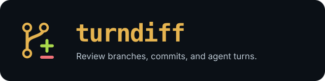
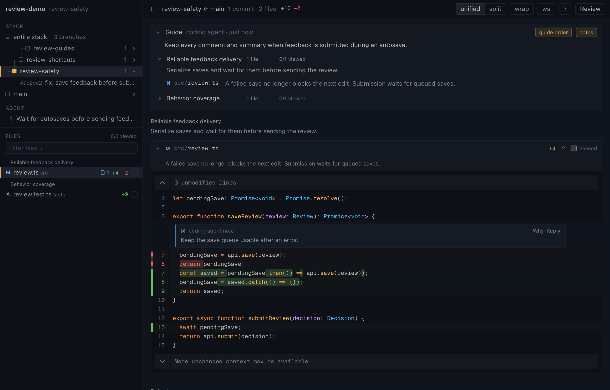
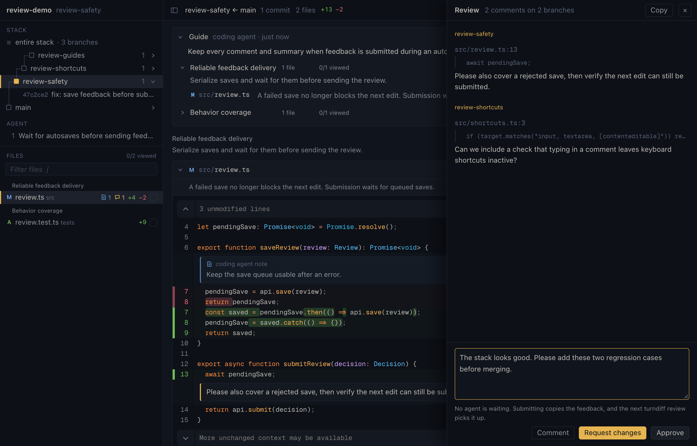

# turndiff

A local review tool for stacked branches and the agents that write them. It reads your git-spice stack, shows each branch against its parent the way a GitHub PR does, lets you step through single commits and commit ranges, and sends every line comment you leave, on any branch, back to the agent as one markdown review.



*Review branches with a stack navigator, an author guide, and inline notes.*



*Collect comments from multiple branches and send one review back to the agent.*

## What you can review

- **A branch** against its parent branch. For the checked-out branch this includes uncommitted changes when there are any.
- **A commit** or a **range of commits**, labeled with the branch each commit belongs to. A range can cross branches of one stack.
- **Uncommitted changes** against `HEAD`.
- **The entire stack**, one section per branch, parents first.
- **An agent turn**, or several, as what each branch gained during those turns.
- **Everything since your last review**, the same way.

Turn and since-review views compare each branch with its own earlier self. If the agent switches from `feat-b` to `feat-a` mid-turn, commits on both and restacks, you see what `feat-a` gained and what `feat-b` gained, and nothing from the restack. Harness turn diffs compare two worktree snapshots instead, so a branch switch shows up as one branch deleting the other's code.

## The UI

The left rail lists the stack the way `git-spice ls` does, children above their parents and the trunk at the bottom. Click a branch for its PR view, expand it to click single commits, and shift-click a second commit or turn for a range. The rail also lists uncommitted changes, the entire stack, and the recorded agent turns. Below the stack sits the file list of the current view. Drag the rail's edge to resize it.

Keyboard: `j`/`k` next and previous file, `]`/`[` next and previous hunk, `v` toggle viewed, `g` guide order or tree order, `a` show or hide author notes, `u` unified or split, `t` switch theme, `r` reload after new changes, `/` filter files, `b` toggle the rail, `c` open the review panel, `?` theme and shortcuts. Two themes ship, Ayu Dark and GitHub Dark, both taken from the Shiki themes that highlight the code. When the agent changes code while you review, a "new changes" pill appears; the view never reloads under you.

## Comments

Select lines in the gutter to comment. A comment is attached to the exact file content it was written on (the blob id), so it appears in every view that shows that content: the branch view, the commit that last touched the file, the stack view. When the code under a comment changes, the comment is marked outdated and keeps its original snippet.

All comments in a worktree form one review, whichever branch or view you wrote them in. Submitting sends them to the waiting agent grouped by branch in stack order, with `git-spice` instructions to fix each on its own branch and restack. With no agent waiting, the UI copies the markdown so you can paste it anywhere.

Viewed marks are also attached to content: a file you marked viewed stays viewed in every view until its content changes.

## Guides

The agent that wrote a branch can leave a review guide for it. turndiff calls no model. The agent writes JSON and pipes it to `turndiff guide`, which checks it against the branch diff, lists every problem at once, and stores it. `turndiff guide --help` prints the format and the writing rules.

```bash
turndiff guide guide.json              # the checked-out branch, uncommitted changes included
turndiff guide - --branch feat-a < g.json
turndiff guide --remove --branch feat-a
```

In branch and stack views, a guide card opens the branch's section. It shows the intent, then one row per guide section with its file count and a "k/n viewed" count. Click a row to jump to that group in the diff, or expand it to read the section's overview and its files with their summaries. Files the guide does not place form an "Everything else" group. The rail and the diff list files in the guide's order, and each group in the diff opens with its title and overview, so you read the explanation right before the code. `g` switches back to tree order.

The guide can also leave notes on line ranges. A note is anchored to the file's content the same way a comment is, so it shows just above the lines it covers wherever that content is diffed, and never moves onto other code. "Why" shows the author's reasoning, and "Reply" opens a comment on the same lines. When the code changes, the guide card tags the file "changed since" and counts the notes that no longer match.

## Install

turndiff runs on macOS and Linux and needs [Bun](https://bun.sh) 1.3.10 or later and git 2.40 or later. It reads git-spice metadata directly from `refs/spice/data`, so the `git-spice` binary is optional.

[Download v0.1.0](https://github.com/meghrp/turndiff/releases/tag/v0.1.0) as `.tar.gz` or `.zip`, extract it to a directory you will keep, and run `./install.sh` inside it. The release includes SHA-256 checksums. This is a source installation, so Bun is required when you run turndiff.

Or clone the repository:

```bash
git clone https://github.com/meghrp/turndiff.git
cd turndiff
./install.sh
```

The script installs the locked dependencies and links the `turndiff` command into Bun's bin directory, usually `~/.bun/bin`. Add that directory to `PATH` if your shell cannot find it. Keep the extracted or cloned directory in place; the command and optional recording hooks link to it. After updating a clone, run `./install.sh` again.

For optional Claude Code turn recording and the agent review skill, run `turndiff install`.

`turndiff install` adds `UserPromptSubmit` and `Stop` hooks to `~/.claude/settings.json` (it writes a backup next to it) and links `skills/turndiff-review` into `~/.claude/skills`. Claude Code and harnesses using its hook protocol can record turns. Other harnesses need to emit the same hook events; installation alone does not enable recording in them. Without the hooks, everything except turn views works. Installation preserves existing hooks and refuses to overwrite a skill directory you created yourself. Repeated installation is safe.

## Use

```bash
turndiff                       # open the UI on the checked-out branch
turndiff --stack               # or pick a starting view: --branch [name], --commit <rev>,
turndiff --range main..feat-b  #   --range <a>..<b>, --working, --turn [n], --turns 2-4, --since-review
turndiff review                # open the UI, wait for the review, print it (what the agent runs)
turndiff stop                  # stop this worktree's review server
turndiff clean --keep 5        # drop old recorded agent sessions and any data left by v0
```

Each worktree gets its own review server, started in the background on first use and reused after that. It restarts on its own port when turndiff's code changes, so an open tab reconnects. `turndiff review --branch feat-a` moves an already open tab to that branch instead of opening a second one. `turndiff review` waits until you submit. Agents run it as a background command, so the harness wakes them with your feedback when it exits. A newer `turndiff review` retires an older one that is still waiting, so one submission wakes one agent. Feedback waiting for an agent is held for 10 minutes in the running server; restarting that server clears the pending delivery. Submitted reviews remain in the history directory. Harnesses without background commands can pass `--timeout 540` and run it again on `Still waiting`.

## How turn comparison works

At each hook event turndiff records a snapshot: the tip and parent of every stack branch, the tip of the trunk's upstream (such as `origin/main`), and a commit of the worktree (tracked and untracked files, honoring `.gitignore`) parented on `HEAD`. Snapshots live under `refs/turndiff/v1/` and never touch your branches, index or stash. One ref per snapshot keeps every recorded commit alive after branches are rewritten.

To compare snapshots `A` and `B`, turndiff takes each branch `X`, with parent `P` as recorded in each snapshot (the trunk's parent is its upstream):

```
a = X in A, b = X in B              # the worktree commit for the checked-out branch, else the branch tip
base_a = merge-base(a, P in A)
base_b = merge-base(b, P in B)
old = a                             if base_a == base_b
old = merge-tree --merge-base=base_a base_b a   otherwise (replays X's old changes onto its new base)
section X = diff(old, b)            # skipped when empty
```

Uncommitted work belongs to the worktree, not to a branch. When the checkout moves from `X` to `Y` and the uncommitted changes come along, they count as already present on `Y` and no longer part of `X`, so a plain `git checkout` shows nothing. When they were committed on `X` first, they count as `X`'s. A branch that did not exist in `A` shows its whole diff against its parent. Commits on the trunk count as local work unless its upstream already has them, so a pull never shows up.

## Where data lives

- `<git-common-dir>/turndiff/v1/sessions/` and `snapshots/`: recorded agent turns, shared by all worktrees. Each server lists only its own worktree's sessions.
- `<git-common-dir>/turndiff/guides/`: one review guide per branch, shared by all worktrees.
- `<worktree git dir>/turndiff/review.json`: the open review (comments, summary, viewed marks).
- `<worktree git dir>/turndiff/history/`: every submitted review with the markdown that was sent.
- `<worktree git dir>/turndiff/server.json`: the running server's port and pid.

## Layout

```
src/model.ts          types and HTTP API shared by the server and the UI
src/git/stack.ts      branches, parents and commits; the change fingerprint the UI polls
src/git/diff.ts       tree diffs as per-file changes with blob ids; worktree snapshots
src/git/views.ts      resolves a target (branch, commits, working, stack, turns) into sections
src/git/snapshots.ts  stack snapshots, hook recording, per-branch comparison
src/git/guides.ts     review guides: checked against the branch diff, stored per branch
src/server/           HTTP server, review store, detached daemon, UI build
src/feedback.ts       the markdown the agent receives
src/ui/               React UI on @pierre/diffs
src/scenario.ts       scratch repo with a stack and a branch-switching, restacking agent turn
```

## Development

```bash
bun run check             # TypeScript and unit/integration tests
bun run build             # build the browser UI from scratch
bunx --no-install playwright-core install chromium
bun test                  # engine and server tests against the scenario repo
bun run e2e               # drives the UI in Playwright Chromium against the scenario repo
bun scripts/scenario.ts   # build a scenario repo and print its path
```

After `bun link`, try the UI by hand with `cd "$(bun scripts/scenario.ts)" && turndiff serve --port 4780`. This builds a scenario repo and runs its server in the foreground. The UI rebuilds when anything under `src/` is newer than `dist/ui/index.html`. Set `PLAYWRIGHT_CHANNEL=chrome` to run the browser checks with an installed Chrome instead. GitHub Actions runs the checks on macOS and Linux.

## Privacy

The server listens only on `127.0.0.1`. Repository content, prompts, guides, and reviews stay on your computer. turndiff calls no model and sends no telemetry. The browser rejects other sites calling its API. Installation downloads dependencies, and links you open in guides can visit external sites.

Turn recording includes tracked and untracked files that Git does not ignore, and stores their contents in local Git objects. Add private files to `.gitignore` before recording. `turndiff clean` removes old session references; normal Git garbage collection can later reclaim the objects.

## Contributing

Run `bun install --frozen-lockfile`, `bun run check`, and `bun run build` before submitting a change. For UI changes, install Chromium with the command above and run `bun run e2e`. Keep changes focused and include a reproduction or behavior test for bug fixes. Use a scratch repository for hook and daemon experiments.

[AGENTS.md](AGENTS.md) provides the same starting instructions for coding agents. Maintainers can run `bun run release` from a clean checkout to create source archives and checksums from `HEAD` in `dist/release/`.

## License

[MIT](LICENSE). Dependencies retain their own licenses.
